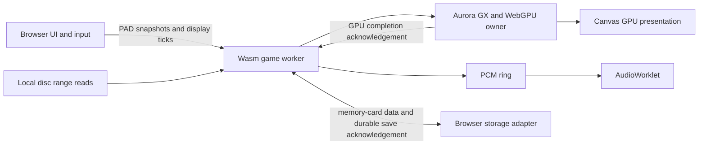

# Browser / WebAssembly feasibility

Assessed September 20, 2026 against the native port at `fadc38f12` and the
subsequent pipeline-cache startup fix. The full-game assessment below remains
applicable. A first [Wasm/WebGPU character prototype](web/README.md) now builds
with locally pinned Emscripten 6.0.9: real disc/model/animation decoding passes
in Wasm, and the small JS WebGPU renderer passes windowless Metal/Dawn checks.
WebKit Simulator passes WORKERFS/worker/animation integration, but supplies no
GPU adapter. Desktop Safari remains unverified because the private Mac VM is
unreachable. No browser gameplay has been implemented or validated.

**Recommendation: proceed with a bounded desktop-browser prototype.** Much of
the difficult game adaptation is reusable. A browser version is a substantial
new platform backend, not a compiler flag applied to the Apple app. Smooth
desktop gameplay is plausible but unmeasured; mobile-browser performance and
memory fit are less certain. Do not promise 60 FPS or parity with the native app.

## What carries over

| Existing component | Browser reuse / work |
| --- | --- |
| Original game C sources, native SDK adaptations | Recompile to Wasm; retain `MELEE_NATIVE` and audit the new ABI. No PowerPC CPU emulator is needed. |
| DAT parsing, endian conversion, owned native objects | Reuse `native/src/archive.c` and the character/stage/item adapters. They already separate serialized offsets from host pointers. |
| Aurora GX translation, WGSL shaders, EFB/XFB handling | Reuse the renderer with an Emscripten WebGPU provider and browser-safe scheduling. |
| Direct presentation | Reuse the fullscreen GPU sampling approach; replace CAMetalLayer/Apple surface ownership with a canvas surface. Preserve opaque output and avoid per-frame CPU readback. |
| AX/ADPCM mixing, THP decoder, PCM ring | Reuse C/C++ processing; replace AVAudioEngine output with Web Audio. |
| PAD snapshots and binding model | Reuse game-side input. Add DOM keyboard/pointer handling and browser gamepad polling; release held inputs on blur/disconnect. |
| Disc/CISO parsing and memory-card format | Reuse formats and validation; adapt random reads and durable writes to browser storage. |
| SwiftUI, UIKit/AppKit, MetalFX | Replace with a browser UI. MetalFX itself is Apple-specific; start with native-resolution WebGPU output. |

Emscripten supports a Dawn-style C/C++ WebGPU API through Emdawnwebgpu, using the
browser's WebGPU implementation. That is a close architectural match, although
its C++ bindings are not stable: pin a compatible Emscripten/Emdawn revision and
audit it against Aurora's current headers. Use the supported port or CMake
integration, rather than trying to embed native Metal/Dawn binaries in Wasm.
[Emscripten WebGPU](https://emscripten.org/docs/porting/multimedia_and_graphics/WebGPU-support.html),
[Emdawnwebgpu](https://dawn.googlesource.com/dawn/+/refs/heads/main/src/emdawnwebgpu/pkg/).

## Concrete obstacles in this tree

1. **Build and ABI.** `native/aurora/CMakeLists.txt` uses Apple linker options,
   native shared-library exports, and native sanitizer targets. Aurora's
   `cmake/aurora_gx.cmake` explicitly links `dawn::webgpu_dawn` and defines
   `WEBGPU_DAWN`; its provider currently chooses native GPU backends. Add a
   separate Emscripten executable target and dependency provider. Keep Apple
   builds unchanged. Start with wasm32, then validate every layout-sensitive
   native adapter. The prototype confirmed `NativeBlock` was 20 bytes on
   wasm32 rather than the required 32; explicit 32-byte alignment now fixes it
   while retaining the assertion. Native heap/diagnostic and Wasm model tests
   pass. The full-game GX ABI audit for the selected pointer width remains.

2. **Blocking and GPU ownership.** The game loop, VI/DVD/CARD workers, Aurora
   FIFO/render workers, and draw-done completion worker use waits and atomics.
   `gpu_completion.cpp` and the FIFO patch use timed `WaitAny`; renderer startup
   also waits for adapter/device acquisition. These need a browser-compatible
   event/callback strategy. A worker cannot block waiting for a promise whose
   callback must run on that same blocked worker. Preserve actual GPU completion
   before releasing GX draw-done; merely draining the CPU command queue is wrong.
   Establish one GPU owner and a proven command/completion bridge before moving
   the whole game. Asyncify is an available technique, not an automatic fix for
   every lock or cross-worker dependency. Google's cross-platform example uses
   it for WebGPU waits and replaces the native loop with browser scheduling.
   [Native/web WebGPU example](https://developer.chrome.com/docs/web-platform/webgpu/build-app).

3. **Thread platform details.** Keep the blocking game loop off the browser UI
   thread. Prototype pthread workers with a precreated pool and a responsive
   main thread; audit the actual worker count and stack sizes. Replace Apple's
   `pthread_cond_timedwait_relative_np` in `alarm_backend.c` and `vi_backend.c`
   with a portable deadline implementation that preserves monotonic timing.
   Shared-memory pthread builds require cross-origin isolation (COOP/COEP), and
   Emscripten warns that main-thread blocking/proxying can deadlock. Hosting must
   supply those headers; a standalone `file://` page is not the deployment model.
   [Emscripten pthreads](https://emscripten.org/docs/porting/pthreads.html).

4. **Memory.** The native phone's recorded 1.5–1.6 GB process footprint is a
   warning, not a measurement of Wasm linear memory: it includes platform/GPU
   allocations. The game arena is 64 MiB and ARAM is 16 MiB, but adapted assets,
   decoded textures, renderer resources, and runtime allocations add much more.
   Do not preload the approximately 1.3 GB CISO into MEMFS or a second giant JS
   buffer. Measure linear heap, browser/GPU memory and peaks during transitions
   separately. Emscripten's growth limit defaults to 2 GiB and can be raised;
   raising it does not establish that a mobile browser can sustain the allocation.
   [Memory settings](https://emscripten.org/docs/tools_reference/settings_reference.html#maximum-memory).

5. **Disc and saves.** `disc.c` uses `pread` and explicit endian decoding, making
   its random-read boundary useful. Start with a user-selected local File/Blob
   and a worker filesystem adapter that reads ranges without copying the entire
   disc. OPFS is another option if importing the disc is desired; its synchronous
   access handles work only in dedicated workers and only for OPFS files, so
   they cannot directly open an arbitrary selected host file. Keep the memory
   card in browser storage, expose import/export, and acknowledge save completion
   only after the chosen persistence backend has flushed. Existing `fsync` and
   rename calls alone do not prove browser durability. Test reload, interruption,
   quota failure and recovery with disposable cards. No disc/assets/saves should
   be bundled into the hosted application.
   [OPFS synchronous access](https://developer.mozilla.org/en-US/docs/Web/API/FileSystemSyncAccessHandle),
   [Emscripten filesystems](https://emscripten.org/docs/api_reference/Filesystem-API.html).

6. **Audio and correctness.** Feed an AudioWorklet from the existing PCM ring
   with explicit sample-rate conversion. Keep its callback nonblocking and
   allocation-free; do not run game logic there. Resume audio through user input
   and verify background/resume behavior. Audit indirect call signatures under
   Wasm: casts accepted by a native ABI can trap with incompatible Wasm function
   types. Validate command interpreters, callback tables, floating-point behavior,
   and 64-bit timing arithmetic rather than assuming the ARM results carry over.
   [Wasm AudioWorklets](https://emscripten.org/docs/api_reference/wasm_audio_worklets.html),
   [Function pointer rules](https://emscripten.org/docs/porting/guidelines/function_pointer_issues.html).

## Suggested prototype sequence and decision gates

Proposed boundaries (GPU worker/proxy details must be proven at gate 2):

1. Pin the toolchain; compile and run the CPU foundation tests under wasm32.
   Fix layout/platform issues with shared code where appropriate. Success means
   real archive parsing, input, math and disposable-card serialization tests pass,
   not merely that an empty `.wasm` file loads.
2. Port a small Aurora GX scene to WebGPU. Verify colors/orientation, texture
   upload, completion ordering and repeated frames with no CPU framebuffer copy.
   Prove worker ownership and async completion here. This is the highest-risk
   architectural gate and should precede a polished UI.
3. Mount a local disc by range reads and reach the title/menu using the original
   game runtime. Capture first-frame latency, shader compilation behavior,
   memory peaks and unsupported GPU features. Negotiate browser-supported
   features rather than requiring Dawn-only extensions or validation toggles.
4. Reach one two-fighter match with keyboard/gamepad input, then add audio and
   persistent saves. Require a ten-minute foreground run, pause/resume, fresh
   reload of a disposable card, and reported frame/audio/memory statistics.
5. Expand to another desktop browser and only then physical mobile browsers.
   Treat mobile feasibility as unresolved until this same workload fits memory
   and sustains acceptable pacing on the target devices.

Feature-detect WebGPU, adapter availability/limits, cross-origin isolation and
audio support. WebGPU requires a secure context and is not universally available;
do not infer compatibility from a browser brand alone.
[WebGPU availability](https://developer.mozilla.org/en-US/docs/Web/API/GPU).

The native startup fix helps this direction too: background shader cache warmup
must not prevent the first frame, while shaders required by actual draws must
still be ready. The initial browser build should leave native Dawn disk-cache
integration disabled and rely on the browser's compilation behavior until its
own cache/persistence policy is designed and measured.

There is no evidence-based completion date yet. The first two gates establish
whether this is a tractable backend adaptation or needs a deeper renderer
scheduling rewrite. Reassess scope after those gates rather than estimating the
whole browser port from the existence of WebGPU alone.
